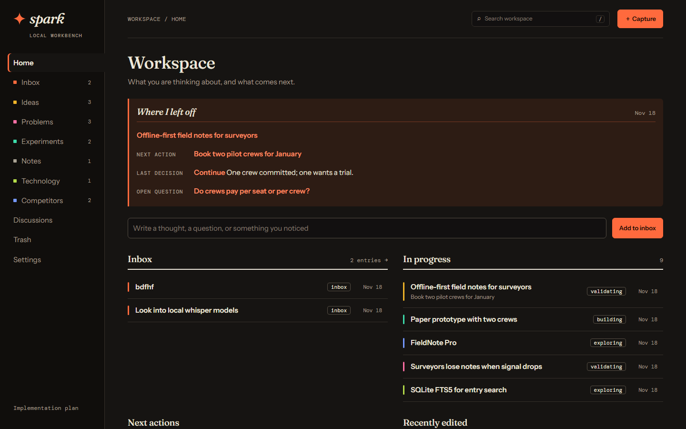
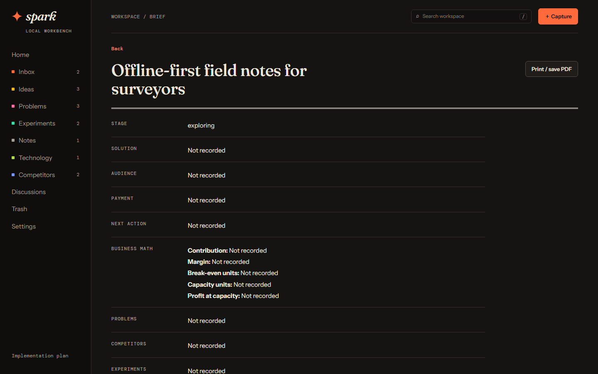

# Spark

A local workbench for capturing thoughts, shaping ideas, and testing assumptions. It runs on your computer, starts empty, and never invents research, metrics, or AI replies.




Screenshots use sample data. The color scheme follows your operating system.

## Features

- **Workspace.** Capture a thought to the inbox, then turn it into an idea, problem, note, technology, competitor, or experiment. Each type has structured fields: an experiment records a hypothesis, test plan, success criteria, results, and a continue, change, or stop decision. Entries can link to each other.
- **Home.** A "Where I left off" summary for the most recent idea (next action, last decision, open question), plus the inbox, work in progress, next actions, and recently edited entries.
- **Search** across titles, notes, structured fields, and saved discussions.
- **Trash and backups.** Trashed entries and discussions can be recovered. Trashing an entry keeps its attachments. Spark writes atomic JSON recovery snapshots, and Settings exports and imports full workspace backups.
- **Attachments.** Save an entry first, then attach files. Limits are 5 MB per file and 20 MB in total.
- **Business math.** A panel on each idea computes contribution per sale, margin, break-even units, and profit at capacity from the numbers you enter.
- **Competitor research.** The idea editor opens an external web search for your query. You record what you found: product facts, audience, pricing with the date checked, gaps, and source links. Spark makes no search API calls.
- **Related research.** Search OpenAlex for papers from the idea editor and save a result as a note. Nothing is saved unless you choose to.
- **Multi-model discussions.** Ask one or more models the same question in solo, roundtable, or team mode. See [Discussions](#discussions).
- **Founder review.** One button starts a parallel review of an idea by five participants: three board lenses (offers, monopoly, product), a CFO, and a launch lead. The idea and its linked entries are the context. The review uses the provider and model of your most recent discussion. Presets are adapted from [founder-skill](https://github.com/Jakeschincariol/founder-skill) by Jake Schincariol (MIT).
- **Printable brief.** `#brief/<id>` shows a one-page view of an idea. **Print / save PDF** uses the light palette and hides the interface.
- **Phone and voice capture.** Capture from a paired phone and record or import audio. See [Phone and voice](#phone-and-voice).

Model output is a draft until you save it. Replies can become a reviewable draft, and nothing is written to your workspace until you give it a title and save.



## Quick start

You need **Node.js 22.13 or newer** (Node 24 or newer recommended). Spark has no npm dependencies and no build step. Storage uses Node's built-in SQLite, so some Node versions print an experimental warning at startup.

```powershell
git clone https://github.com/jvitorbarros15/spark-personal-lab.git
cd spark-personal-lab
npm start
```

Spark opens at **http://127.0.0.1:4173**. On Windows you can double-click **Start Spark.cmd** instead, which checks your Node version and opens the browser. Keep the terminal open; Ctrl+C stops the server. `node server.cjs` starts the server without opening a browser.

The server binds to loopback only.

## Phone and voice

### Pair a phone

Phones need an HTTPS gateway with a certificate you supply. The phone must reach the gateway address on your private LAN or VPN, and it must trust the certificate. Keep the private key outside the repository.

```powershell
$env:SPARK_PHONE_BIND = '192.168.1.40'
$env:SPARK_PHONE_ORIGIN = 'https://spark.example.internal:4443'
$env:SPARK_PHONE_CERT = 'C:\certs\spark-chain.pem'
$env:SPARK_PHONE_KEY = 'C:\certs\spark-private.pem'
node phone.cjs serve
```

In a second terminal, run `node phone.cjs pair`. Open the HTTPS origin on the phone and enter the one-use code within ten minutes. A paired device has access for 30 days. Use `node phone.cjs devices` to list paired devices and `node phone.cjs revoke DEVICE_ID` to revoke one. Keep both processes running. Spark does not configure DNS, install certificates, or open firewall ports.

### Capture voice

Choose **Capture → Save entry and record** and allow microphone access. The original audio stays on your computer. You can also import an audio file into a saved entry.

Transcription uses one of two paths:

- **Local:** run an OpenAI-compatible speech-to-text server on your computer. In **Transcription settings**, enter its loopback base URL and model name.
- **OpenAI:** configure an API key in Settings and confirm that the audio may be sent to OpenAI.

Review the transcript, correct it, and add it to the entry's notes. Search includes the corrected text. You can replay the audio or retry transcription later.

## Providers and privacy

| Provider           | Adapter                                  | Credential                                             |
| ------------------ | ---------------------------------------- | ------------------------------------------------------ |
| OpenAI             | Responses API, streaming, `store: false` | `OPENAI_API_KEY` or Settings                           |
| Anthropic / Claude | Messages API, streaming                  | `ANTHROPIC_API_KEY` or Settings                        |
| Google / Gemini    | `streamGenerateContent`, SSE             | `GEMINI_API_KEY` or Settings                           |
| Local              | OpenAI-compatible chat completions       | Optional `LOCAL_API_KEY`; `LOCAL_BASE_URL` or Settings |

Ollama's usual base URL is `http://127.0.0.1:11434/v1`. LM Studio usually serves `http://127.0.0.1:1234/v1`. Start the local server first. Spark does not install models or start these applications.

After saving a provider in Settings, select **Check connection / models**. Model lists can include models that do not support text chat, so choose a compatible one.

Privacy principles:

- **Keys stay on your machine.** Environment variables take precedence over Settings. Keys entered in Settings are written as plain text to `data/secrets.json`, which is git-ignored. Settings endpoints never return keys, and backups never include them. `.env` files are not loaded automatically.
- **Local-only mode** prevents Spark from selecting cloud providers. The local adapter accepts only loopback URLs and refuses redirects. A local server can still route requests to a cloud model, so use a genuinely local model if you need offline inference.
- **Cloud providers receive the context you select**, under their own data policies. The `store: false` setting for OpenAI does not guarantee zero retention.

## Discussions

1. Configure a provider in Settings and run **Check connection / models**.
2. Open **Discussions → New discussion → Participants & context**.
3. Give each participant a role, a provider, and an exact model ID. Model IDs can come from discovery or be typed in.
4. Select the entries to include as context and preview them before sending.
5. Choose a mode and send a message. Configuration is saved before each send.

Modes:

- **Solo:** the first participant replies. Change its provider or model to switch models and keep the history.
- **Roundtable:** participants answer the same input at the same time. First-round replies cannot see each other.
- **Team:** one to three rounds. Each later round receives the previous round for critique. Up to six participants.
- **Send to:** address one participant without changing the saved team.
- **Summarize discussion:** a chosen participant writes a synthesis. It is a model suggestion, not a verified consensus.

Roles are independent of models: Explorer, Problem investigator, Skeptic, Builder, Business analyst, and Moderator. Each accepts custom instructions. **Reuse team** copies a setup into a new discussion without its messages.

Responses stream with their provider, model, and role. **Stop** cancels a run and keeps partial replies. A failed or cancelled reply can be retried alone. **Inspect sent context** shows the exact text sent for a reply.

Limits: each request allows 4,096 output tokens and each run times out after five minutes. Retries are never automatic. Usage is shown when the provider reports it. Spark does not cap spending, and cancelling cannot undo charges for tokens already generated.

## Context and limits

- The latest 24 discussion messages are sent. Older messages stay saved and searchable. Oversized context is rejected with an error rather than truncated silently.
- Text attachments (`.txt`, `.md`, `.csv`, `.json`, `.log`) are included up to 20,000 characters per file and 60,000 characters per request. Truncation is marked in the inspected context.
- Images, PDFs, and other binary files are stored and downloadable but are not sent to models.
- Chat is text-only. Models have no web browsing, shell, or action tools, so they cannot verify market claims.
- Responses render as plain text. Model HTML does not execute, and some Markdown syntax appears literally.

## Data

Everything lives in the git-ignored `data/` folder:

```text
data/spark.sqlite       Entries, sessions, messages, attachment metadata
data/attachments/       Content-addressed file bytes
data/backups/           Latest 20 JSON recovery snapshots
data/secrets.json       Optional provider keys (never backed up)
```

Backups are created after saved changes and around imports. They contain records, conversations, and attachment bytes. An automatic backup on the same disk does not protect against losing the computer, so use **Settings → Export workspace** to copy one elsewhere.

Imports are validated before any data changes. **Merge** overwrites records with matching IDs. **Replace** moves existing records to trash, creates a recovery snapshot first, and applies the backup. Interrupted replies are marked cancelled on restart, with their partial output kept.

## Project layout

- `server.cjs`: HTTP server, API routes, static files, origin and host checks.
- `store.cjs`: SQLite storage, validation, soft delete, backups, import and export.
- `providers.cjs`: provider adapters, streaming, and role prompts.
- `attachments.cjs`: attachment storage and size limits.
- `voice.cjs`: transcription requests to local or OpenAI endpoints.
- `papers.cjs`: OpenAlex paper search.
- `phone.cjs`: HTTPS gateway for paired phones and the device CLI.
- `dist/index.html`: the single-page app shell.
- `dist/assets/app.js`: main interface: views, editors, discussions, brief.
- `dist/assets/business-math.js`: business math calculations.
- `dist/assets/voice.js`: recording, import, and transcription UI.
- `dist/assets/phone-nav.js`: search shortcut for phone layouts.
- `dist/assets/style.css`: styles, using the tokens in DESIGN.md.
- `dist/assets/fonts/`: self-hosted fonts and their OFL licenses.
- `*-test.cjs`: tests, run by `npm test`.
- `Start Spark.cmd`: Windows launcher.
- `DESIGN.md`: design direction, palette, type, and motion.

## Tests

```powershell
npm test
```

The suite checks the JavaScript syntax of the server, store, and frontend, then runs tests against real local HTTP endpoints, SQLite restart durability, validation, soft deletion, attachment backups, origin and host checks, streaming provider protocols, parallel isolation, team rounds, retries, cancellation, and safe rendering. Provider tests use local mock servers, so they spend no credits and do not verify live models. Visual checks in a browser are still manual.

## Design

See [DESIGN.md](DESIGN.md) for the palette, type scale, spacing, motion rules, and the reasons behind them.

## Contributing

Issues and pull requests are welcome. Run `npm test` before opening a pull request, and keep changes small and focused. The project has no runtime dependencies, so please avoid adding one unless it earns its place.

## Credits

- Founder review presets are adapted from [founder-skill](https://github.com/Jakeschincariol/founder-skill) by Jake Schincariol, MIT licensed.
- Typefaces are Fraunces, Instrument Sans, and DM Mono, self-hosted under the SIL Open Font License 1.1. License texts are in `dist/assets/fonts/`.
- Paper search uses the [OpenAlex](https://openalex.org) API.
- Protocol references: [OpenAI streaming](https://developers.openai.com/api/docs/guides/migrate-to-responses#7-update-streaming-consumers), [Anthropic streaming](https://platform.claude.com/docs/en/build-with-claude/streaming), [Gemini content generation](https://ai.google.dev/api/generate-content), [Ollama OpenAI compatibility](https://docs.ollama.com/api/openai-compatibility).

## License

License: to be decided.
