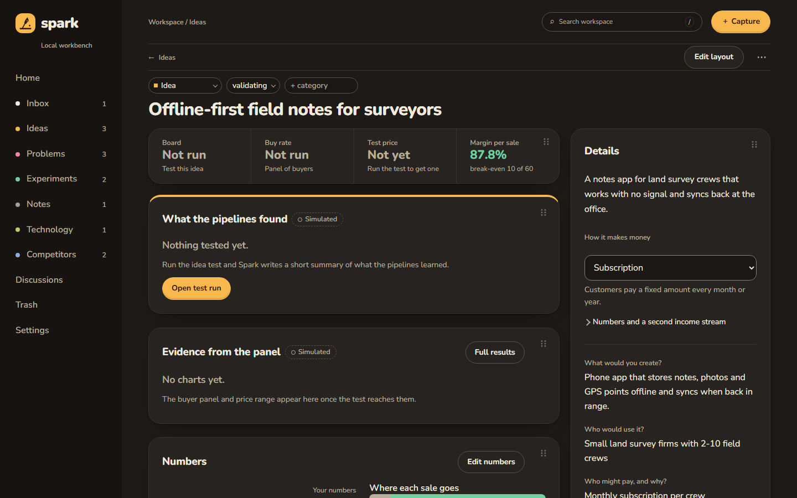
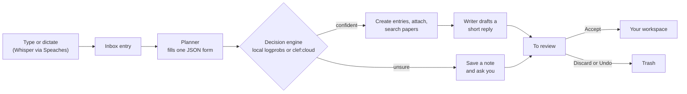
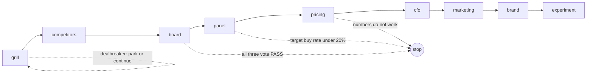

<p align="center"></p>

<p align="center"><b>LOCAL-FIRST · PRIVATE BY DEFAULT · OLLAMA · OPENAI · ANTHROPIC · GEMINI</b></p>

<p align="center">
  
  
  
  
</p>
<p align="center">
  
  
  
  
</p>

# Spark

A local workbench for capturing thoughts, shaping ideas, and testing assumptions. It runs on your computer and starts empty. Anything a model writes is marked, kept apart from your evidence, and waits for your review.


Screenshots use sample data. The color scheme follows your operating system.

## Features

- **Workspace.** Capture a thought to the inbox, then turn it into an idea, problem, note, technology, competitor, or experiment. Each type has structured fields: an experiment records a hypothesis, test plan, success criteria, results, and a continue, change, or stop decision. Entries can link to each other.
- **Home.** A "Where I left off" summary for the most recent idea (next action, last decision, open question), plus the inbox, work in progress, next actions, and recently edited entries.
- **Search** across titles, notes, structured fields, and saved discussions.
- **Trash and backups.** Trashed entries and discussions can be recovered. Trashing an entry keeps its attachments. Spark writes atomic JSON recovery snapshots, and Settings exports and imports full workspace backups.
- **Attachments.** Save an entry first, then attach files. Limits are 5 MB per file and 20 MB in total.
- **Business math.** A panel on each idea computes contribution per sale, margin, break-even units, and profit at capacity from the numbers you enter.
- **Competitor research.** The idea editor opens an external web search for your query. You record what you found: product facts, audience, pricing with the date checked, gaps, and source links. This button makes no search API calls. The idea test can search the web itself when a web search key is set (see [Web search](#web-search)).
- **Related research.** Search OpenAlex for papers from the idea editor and save a result as a note. Nothing is saved unless you choose to.
- **Literature research.** "Research this idea" runs a staged literature pass: a research frame, search and snowballing, relevance screening that you control, a literature map, a differ table and a draft next study. Papers are verified against Crossref or arXiv, quotes must match a stored abstract, and references export as BibTeX. See [The research pipeline](#the-research-pipeline).
- **Multi-model discussions.** Ask one or more models the same question in solo, roundtable, or team mode. See [Discussions](#discussions).
- **Idea testing.** "Test this idea" in the idea editor runs a sequential pipeline: a grill (rounds of questions with recommended answers, adapted from the grilling skill by Matt Pocock, MIT, see [licenses](licenses/mattpocock-skills-MIT.txt)), a three-lens board and chair, a competitor scout (web search when a key is set, otherwise model memory), a seeded buyer panel (20 buyers, or 100 on request), Van Westendorp pricing, unit economics from a CFO step, a marketing plan, brand ideas and a draft experiment. One job runs at a time, at most 40 model calls per job (Resume grants 40 more), cancellable and resumable, with unchanged stages reused on a rerun, and failed stages can be retried. See [The idea test pipeline](#the-idea-test-pipeline). Everything a model writes is marked Simulated, waits under To review, and never fills evidence fields. The same idea can be exported to a folder and tested in Claude Code instead; you run those commands yourself and import the results.
- **Founder review.** One button starts a parallel review of an idea by five participants: three board lenses (offers, monopoly, product), a CFO, and a launch lead. The idea and its linked entries are the context. The review uses the provider and model of your most recent discussion. Presets are adapted from [founder-skill](https://github.com/Jakeschincariol/founder-skill) by Jake Schincariol (MIT).
- **Idea dashboard.** An idea opens as a set of cards: key numbers, summary, evidence, numbers, business model, work on this idea, branches, competitors, details, stages, research, and links. Use **Edit layout** to move, widen (one to three columns) or compact a card, and **Reset layout** to restore the default. The layout is saved in `ui-layout.json` in the data folder.
- **Capture classifier.** A decision model types each new capture as an idea, problem, experiment, technology, competitor or note, with a probability for each. Unsure captures stay in the inbox with a question, captures with several clear topics are split into linked entries, and your type corrections guide later guesses. Private captures are always typed by the local model; other captures use `clef:cloud` when it is reachable. See [From capture to assistant](#from-capture-to-assistant).
- **Revenue models.** An idea can make money in twelve ways, from subscriptions to grants. See [Revenue models](#revenue-models).
- **Language.** The interface and model output can be English or Brazilian Portuguese. See [Language](#language).
- **Family.** One private Spark per family member on the same computer, with optional public addresses. See [Family](#family).
- **Printable brief.** `#brief/<id>` shows a one-page view of an idea. **Print / save PDF** uses the light palette and hides the interface.
- **One-tap dictation.** The home page has a **Record** button beside the capture box. Press it, speak, press it again. The audio is saved, transcribed, and added to the inbox as a new entry whose transcript you can review. Ctrl+K (Cmd+K on macOS) returns to home and focuses the capture box.
- **Phone capture.** Capture from a paired phone. See [Phone](#pair-a-phone).



Model output is a draft until you save it. Replies can become a reviewable draft, and nothing is written to your workspace until you give it a title and save.


## Quick start

You need **Node.js 22.13 or newer** (Node 24 or newer recommended). Spark has no npm dependencies and no build step. Storage uses Node's built-in SQLite, so some Node versions print an experimental warning at startup.

```powershell
git clone https://github.com/jvitorbarros15/spark-personal-lab.git
cd spark-personal-lab
npm start
```

Spark opens at **http://127.0.0.1:4173**. Open the app, then type a thought in the capture box or press **Record** to dictate. Discussions work out of the box with a local [Ollama](https://ollama.com) server at its default URL, with no key. Other options are in [Providers and privacy](#providers-and-privacy).

On Windows you can double-click **Start Spark.cmd** instead. It checks your Node version, starts the `spark-whisper` Docker container if Docker is installed (see [Local transcription](#local-transcription)), and opens the browser. Keep the terminal open; Ctrl+C stops the server. `node server.cjs` starts the server without opening a browser.

For several people on one computer, use **Start Family.cmd** (see [Family](#family)).

The server binds to loopback only.

## How it works

Spark is a small Node server with a SQLite file and a single-page frontend. The interesting part is what happens after you capture a thought. Models do the drafting, but the code decides what a model is allowed to touch, what it costs, and what counts as evidence. Three rules hold everywhere:

- **Generated is not evidence.** Everything a model writes is stored with an origin (`assistant` or `simulation`) and an unreviewed flag. It sits in **To review** until you accept it. While unreviewed, it cannot fill an evidence field (an experiment's results or decision, a problem's evidence, a competitor's pricing or sources, an idea's price and cost inputs), and an idea cannot move to *validating* without an experiment whose results you wrote yourself.
- **Local first.** Small decisions run on a local model. The exceptions are capture typing and splitting, which use the `clef:cloud` decision model for entries that are not private, and long writing. Cloud models are used only only when you configured them, only inside a budget, and never for [Private](#private-entries-and-fail-closed-rules) entries.
- **Everything is stoppable.** Each run can be cancelled, undone or resumed, and a restart never loses finished work.

### From capture to assistant



**Capture and voice.** A capture is an inbox entry. Dictation records audio, saves it, sends it to a speech-to-text server on loopback (by default [Speaches](https://github.com/speaches-ai/speaches) running faster-whisper, see [Local transcription](#local-transcription)), and uses the transcript as the entry body. With the assistant on and **run on capture** enabled, each new capture is queued for it. One capture runs at a time, up to 10 wait in the queue, and a run is limited to 3 model calls and 10 minutes.

**Planner.** The planner model returns one small JSON form: an intent, an entry type, a title, a few fields it can copy from the capture, an optional entry to attach to (chosen from an index of your 50 most recently edited reviewed entries, never from ids it invents), and an optional paper query. It is told never to write evidence, results, prices or numbers, and the code drops any field outside a per-type allow list. If the reply is not valid, Spark asks once for a repair. If that fails too, it falls back to a plain idea draft built from your own words and skips the decision engine.

**Decision engine** (`decide.cjs`). The planner's guess at intent is not trusted on its own. A decision model answers multiple-choice questions and the engine gets a real probability for each option instead of a self-reported confidence. With a local Ollama model it reads the log probabilities of the answer token. With `clef:cloud` (see below) the model returns the probabilities itself.

- The engine talks to Ollama on loopback. The local model setting refuses cloud model names.
- **Capture classifier** (`classify.cjs`). Each capture is typed as an idea, problem, experiment, technology, competitor or note, and a second question asks whether it is a new entry, an addition to an existing one, or a question.
- **Unsure captures** stay in the inbox as notes. Spark asks, for example, "Is this an idea (62%) or a problem (25%)?" when the top type is below the threshold (0.6 by default), the top two are less than 0.15 apart, or the options hold less than half the probability. It does not guess.
- **Split captures.** A capture of up to five sentences is split at sentence ends, semicolons and spoken connectors such as "and then", when at least two different types are each confident. Each part becomes a draft entry, linked to the others. Fragments under three words are joined to a neighbour, and at most three entries are made.
- **Owner corrections.** Changing the type of an entry the classifier filed is recorded as a correction, marked private if the entry was. The most relevant corrections (those sharing words with the capture first) are shown to the classifier as examples. The last 200 are kept in the workspace.
- **Cloud classifier.** For captures that are not private, the type and split questions go to `clef:cloud`, a decision model reached through Ollama's `/v1/systemone`. It returns a probability per option directly, sharpened with a fitted temperature (0.29). Private captures, captures linked to a private entry, and any cloud failure use the local model (`gemma4:e4b` by default); after a failure Spark stays local for 60 seconds. Only corrections made on non-private entries are shown to the cloud model. Set `decision.cloudModel` to an empty string to keep everything local. In the decide-eval benchmark (82 typed captures) `clef:cloud` was right 97.6% of the time against 91.5% for `gemma4:e4b`, with no wrong answer above 0.6 confidence.
- A planner suggestion to attach a capture to an existing entry must also pass a yes/no check from the engine (P(yes) at least 0.5) and an embedding check with `bge-m3` (cosine similarity at least 0.58). Otherwise the attachment is dropped.
- Per-question temperature scaling can be calibrated against labelled examples (`decide-eval.cjs`), and embeddings are cached in SQLite by content hash.
- The same engine screens papers by relevance in the research pipeline.

**Marked entries, Undo and review.** Entries made by a run carry the run id, the stage and the model name, and are marked as drafts. **Undo** on a run moves everything that run created to trash and removes its links. In **To review** you accept or discard drafts one by one or per run. If paper search is on and the entry is not private, the run saves one reading-list note of up to the configured number of papers (5 by default) (OpenAlex first, see [research](#the-research-pipeline)) instead of many separate entries. The reply the assistant writes only reports actions the code actually took, and it may mention only papers from that list.

### The idea test pipeline

"Test this idea" in the idea editor runs nine stages in order. Stages run through three model roles set in Settings: the **planner** (small structured decisions), the **writer** (long prose) and the **simulation** model (played board members and buyers). Writer defaults to planner, and simulation defaults to writer, so one local model is enough to start.



| Stage | Role | What it does | What it writes | Gate |
| --- | --- | --- | --- | --- |
| **grill** | writer | Up to 3 rounds. Each round asks at most 5 questions that follow a design tree of decisions, each with a recommended answer. The job waits for your answers. | A discussion thread, no entries | A model can flag a dealbreaker. You can **park** the idea (its stage becomes *parked*) or answer anyway. Resuming past a parked idea needs an explicit override, which restores the previous stage. |
| **competitors** | writer | With a web search key, the scout plans up to 6 searches, reads the results, and fetches the pages it picks, so each competitor can carry its price and links. Without one, a model lists up to 8 direct, indirect and substitute competitors and the visible gap from memory. | One entry per name, titled "(confirmed by source)" or "(unconfirmed)". Sourced entries link to their pages. Memory-only entries have no pricing or sources. | None. Memory-only entries are guesses: add a source and a date to confirm one. If a search fails, the stage falls back to memory and says why. |
| **board** | simulation | Three lenses (offers, monopoly, product) each score the idea out of 10 and vote, then a chair summarises agreement, disagreement and the one thing to test. | One note, "Board memo (simulated)" | Stops if all three vote PASS. |
| **panel** | simulation | Drafts a customer profile and waits for you to approve it. Then deals 20 buyers (100 on request) across the profile's income, age, behaviour and objection mix, seeded by the idea id so reruns are stable. Buyers answer in batches (4 per call, 10 for 100) and any missing answers are retried once. | One note with the yes-rate overall and by segment, top reasons to pass, what would flip a no, and each buyer's four price answers | Stops if the buy rate in the largest target segment is under 20%. If fewer than half the buyers answered, the result is marked inconclusive instead of gating. Needs "What it is" and "Who it is for" on the idea. |
| **pricing** | none (arithmetic) | Van Westendorp price range from the panel's four price answers, set against competitor prices you confirmed with a source, then business math at the simulated price and at your own price. | One note, "Pricing (simulated)". Your price fields are never changed. | Stops if contribution per sale is zero or negative, or break-even exceeds capacity. |
| **cfo** | writer | Unit economics in the idea's revenue model: kept per sale, margin, break-even (in the model's own unit, such as visitors a month for ads or grants a year), year 1 month by month, cash needed and payback. Inputs you left empty are estimated and marked as assumptions. | One note, "Unit economics (simulated)" | None |
| **marketing** | writer | Three positioning options, two or three channels, ten hooks that each answer one panel objection, a budget split and the cheapest real test with its success line written first. | One note, "Marketing plan (simulated)" | None |
| **brand** | writer | Name ideas, voice, a one-line promise and a look brief, from the positioning and the simulated buyers. Lists the trademark, domain and handle checks that are yours to run. | One note, "Brand (simulated)" | None |
| **experiment** | planner | Turns that cheapest real test into a draft experiment: hypothesis, plan, success criteria. | One experiment entry. Results and decision stay empty for you to fill. | None |

The panel is deliberately labelled as a limit, not a result. Every buyer is the same model, so they share its biases. The note says the yes-rate is an upper bound and not evidence of demand.

**Gates and overrides.** A gate stops the job and shows its reason. To continue you override that gate explicitly, or change the idea and start again. An override is remembered for that exact stage input.

**Call cap.** A test job is limited to 40 model calls. At the cap the job stops with a note, and **Resume** grants another 40.

**Stage cache.** Each stage's input is hashed from the stage name, the model, your idea's title, notes and fields, the outputs of every earlier stage, and stage-specific inputs (panel size, confirmed competitor prices, the approved profile). If a later job on the same idea has a finished stage with the same hash and the entries it wrote still exist, the stage is reused for zero calls. Change a field and that stage and everything after it rerun. A rerun stage moves its own earlier, unaccepted note to trash and writes a fresh one, so notes do not pile up and any edits you made stay recoverable. Notes you accepted are never touched.

**waiting_user, cancel, resume and restart.** The job parks in `waiting_user` when it needs you: grill answers, profile approval, or missing idea fields. **Cancel** aborts the current call. If Spark stops mid-run, finished stages are kept. On the next start, interrupted jobs are marked *stopped*, and a stage that was running goes back to pending, so **Resume** continues from the first unfinished stage. One job runs at a time, and an idea can have only one active test. A test can be scheduled for off-peak hours (see below).

**Retry and updates.** A stage that failed or stopped incomplete shows a **Retry this step** button on its card. Retry is refused while the test is running. It resets that stage and runs it again under the same cache rules. The retry API (`POST /api/jobs/:id/retry`) also accepts `with` (other stages to reset), `rerunLater` (reset every later stage that depends on the retried one, used by the idea chat's **Rerun affected steps**), and options to re-ask the panel or redraft the buyer profile. A stage built on older results shows **Update from new results**. Separately, a model call that fails with a transient error (rate limits, 502 to 504, timeouts, overload, or a dropped or refused connection) is retried automatically, twice, after 1.5 and 4 seconds.

### Business model, idea chat and branches

Three more cards on the idea dashboard build on the test results.

**Business model canvas.** After the summary, a writer step fills the nine Business Model Canvas blocks from the pipeline outputs only: the panel's segments and objections, the competitor gap, pricing and the CFO numbers, the marketing channels, the brand promise, the board's conditions and the experiment. Every bullet carries small tags naming the stages it came from, and a bullet that cites nothing real is dropped, so a block with no support stays empty. The step is hash-cached like the summary, with **Regenerate** and a per-step Retry, and a failed canvas never fails the test. Each block is click-to-edit. Your lines are marked **You** and are never overwritten: regenerating only offers new wording for a block you edited, which you take or dismiss. The canvas is stored on the idea itself, so it is part of backups and exports.

**Verdict.** Above the canvas, the verdict is computed, never written by a model. The rules come from the founder-plan skill (MIT, see `licenses/founder-skill-MIT.txt`): each sale earns money before fixed costs, year 1 makes an operating profit, break-even fits inside capacity, and at least 25% of the simulated buyers buy. All pass is **Profitable**; any failure is **Not yet** with each failing number and what to change; no unit economics is **Incomplete**, with what is missing and the action that fixes it. **Download one-page summary** exports the verdict, numbers, canvas and evidence as Markdown for a partner or lender.

**Work on this idea.** A chat card reuses the discussion sessions, providers, cost layer and Private rules. The model reads the idea and every pipeline output, including the canvas and the simulated buyers' reasons. It can propose changes as structured suggestions, shown as diff chips (old text, new text) that you accept or reject one by one. Accepting is an owner edit, and the model can never propose a price, cost or hours field. After accepting, **Rerun affected steps** calls the retry API (`POST /api/jobs/:id/retry` with `rerunLater`) for the stages whose inputs changed, or offers a new test when there is none. A private idea's conversation stays on a local model.

**Branches.** **Branch this idea** (or a suggested branch, or a single change via "Branch instead") creates a linked child idea with the proposed changes and a "what's different" note, stored with a `branch-of` connection. It has its own dashboard and runs its own test. **Give me 3 pivots** returns three branch proposals, each one click to create. The **Branches** card compares the original and its branches side by side on buy rate, test price, margin, board score and verdict, and outlines the version that passes the most checks once at least two are tested.

### Revenue models

The owner picks how the idea makes money, and optionally a second stream. The twelve models are subscription, one-time sale, freemium, ads, marketplace commission, pay per use, licensing, services, business contracts, donations, grants and research funding, and not monetized yet. The choice sets three things:

- The questions the buyer panel asks: whether they would buy at a price, upgrade, how much they would use it, or, for licensing and contracts, whether the decision-maker would take a meeting or pilot. Grants skip the panel, since a buyer panel says nothing useful about a grant.
- The inputs the income model needs, such as visitors and revenue per 1,000 pageviews for ads, a take rate and volume for a marketplace, or billable hours and a rate for services. Each input is a field on the idea.
- How the other stages talk about it: the grill asks about traffic, funding or funders instead of who pays, the board sees the model and your numbers, and marketing says "would use" rather than "buys" when nobody pays per unit.
- Break-even in the model's own unit on the money card and in the CFO note: visitors a month for ads, sales volume for a marketplace, grants a year for grant funding, free users for freemium, and so on, or "never" when one unit earns nothing.
- The income streams and the CFO's label. Subscriptions and one-time sales also feed the unit economics. The label reads Profitable or Not yet, or Funded by grants for grant-funded research, or Not a business yet when there is no revenue plan.

If the owner leaves the model empty, Spark guesses: a price means subscription, otherwise a writer call picks a model from the idea text, with keyword matches as a fallback, and an idea with no sign of income is treated as not monetized yet. Every guess is labelled as a guess. A price more than five times the median competitor price is flagged. With web search on, some models (such as ads, marketplace commission, licensing and donations) also get a few public benchmark facts, each with its link.

### The research pipeline

Research is a separate job for an idea, for literature work. It is built around the idea that a paper you cite must actually exist.

| Stage | Role | What it does | Gate |
| --- | --- | --- | --- |
| **frame** | writer | Drafts a research question, contribution, method and population from the idea. You edit them and may list papers you already know. One optional follow-up round asks up to 3 questions if the frame is too vague to search. | Waits for you. Writes a "Research frame" note. |
| **search** | writer | Proposes 3 to 5 queries from broad to narrow, and you edit and approve them. Each query runs against paper sources. Then one snowball step follows references and citations (depth 1) from up to 5 seed papers: DOIs from your frame first, then the most corroborated hits. | Waits for query approval. Stops adding at 60 candidates from queries and 80 in total, and says so. |
| **screen** | local decision engine | Scores each candidate 0 to 3 for relevance from title and abstract, using the same logprob method, and records an embedding similarity alongside. Without the engine, the simulation model rates batches of 10. | These are suggestions only. You mark each paper include, exclude or maybe and press Done. |
| **map** | writer | Themes, a timeline from metadata and model-suggested gaps, using the 30 best included papers. | Needs at least one included paper. |
| **differ** | writer | Compares your frame with up to 5 papers on question, method, population, data, evaluation and limitations. Each row states its evidence level: metadata, abstract or full text. It then runs up to 3 follow-up queries to test each claimed difference and flags hits that may undercut your novelty. | Needs at least one included paper. |
| **next** | writer | Drafts one next study (replicate, extend or competing explanation) as an experiment entry with empty results. | None |

**Verified papers.** A paper becomes a candidate only if it is verified.

- Search asks OpenAlex first, and adds Crossref and arXiv when OpenAlex is down or returns fewer results than asked for.
- Results are merged by DOI, arXiv id and normalised title.
- A paper with a DOI is kept if Crossref returned it, or if Crossref's record for that DOI has a matching title. A paper without a verifiable DOI is kept only if arXiv returned it. Everything else is dropped and counted as "unverified dropped".
- Titles, authors and years come from the source record, never from a model.

**Quote validator.** Models cannot put words in a paper's mouth. Any quoted sentence in a map or differ note must appear verbatim in the paper's stored abstract, or it is replaced with `[quote removed: not found in a stored abstract]`. The cite check, which sorts included papers into *supports* and *challenges* for a claim you type, shows a quote only if it is an exact abstract match, and otherwise says "No verifiable quote; read the abstract."

**BibTeX and the search log.** `references.bib` is generated from the verified, included papers only, with escaped fields and unique keys. Every query, snowball step and follow-up is written to a search log with the sources tried, hits, verified and dropped counts, and a timestamp. Every output ends with a reminder that a limited search shows what it found, not that nothing else exists. A research job starts with a cap of up to 30 model calls (you can lower it), and Resume adds 30 more.

### Model routing and cost

```text
role (planner / writer / simulation)
  -> private entry?          -> run on the local model
  -> needs structured JSON?  -> run on the local model
  -> cloud model, no price?  -> run on the local model
  -> would pass the budget?  -> run on the local model
  -> otherwise               -> the chosen model, cost recorded
```

Every call goes through `cost.cjs` before it reaches a provider (`providers.cjs`).

- **Local by default.** The planner, the decision engine and anything needing structured output run on your own Ollama. The one exception is capture typing for entries that are not private, which uses `clef:cloud` (see [Decision engine](#from-capture-to-assistant)). Models whose names end in `:cloud` or `-cloud`, or any non-local provider, count as cloud.
- **Cloud only for heavy writing.** A cloud model is used for prose when it has a price, the budget allows it, and the entry is not private. Structured-JSON calls always stay local. The default price table covers Ollama Cloud models (DeepSeek V4.1 Flash and V4 Pro, Kimi K3, GLM 5.3, gpt-oss 120b) in dollars per million tokens, and you can edit it. A cloud model with no entry in the table runs locally instead, so an unpriced model can never spend money.
- **Ledger.** Each call writes a usage row (model, tokens, cost, off-peak flag, whether the token counts were estimated). **Settings** shows the month's spend by model, by feature and by run, and each Test and Research button shows an estimate based on your past runs.
- **Budget cap.** The monthly budget defaults to $5. Before each cloud call Spark adds the call's estimate to month-to-date spend, including calls in flight. If that would pass the cap, the call runs locally instead and the run records why.
- **Off-peak.** Cloud prices for some models are halved off-peak. Spark treats weekends and 18:00 to 12:00 UTC on weekdays as off-peak. A test or research run can be scheduled to wait for the next off-peak window, and a scheduled job survives a restart.

Measured on real runs with DeepSeek V4.1 Flash as the writer at off-peak prices:

| Job | Cost |
| --- | --- |
| One capture | about $0.00025 |
| One idea test, up to the panel gate | about $0.003 |
| One research run | about $0.00006 |
| A heavy month | about $0.35 |

Peak prices are twice those. In the same measurement, the local `gemma4:e4b` model handled 95 of 137 calls, which is why the totals stay small. Your numbers will vary with models and prices. The budget cap and the ledger exist so they cannot surprise you.

#### Private entries and fail-closed rules

Mark an entry **Private** and nothing about it leaves the computer. A job also counts as private if the idea is linked to a private entry.

- All model calls for it run on a local model, even if a cloud model is chosen, including capture typing.
- Paper search is skipped for a private capture, and a private idea's research job refuses outbound requests (paper search, snowball, DOI lookups and full-text fetches).
- A non-private capture's workspace index never includes private entries, and discussions that include one are marked local-only.

Where a check cannot be answered safely, Spark stops or falls back to local instead of guessing: no price means local, an exhausted budget means local, and if no truly local model exists the job fails with an error instead of using the cloud. A local endpoint that is not Ollama at `127.0.0.1:11434` is treated as a cloud route unless you mark it local and private in Settings, because a gateway can forward to the cloud. The decision engine refuses non-loopback addresses, its local model setting refuses cloud model names, and it sends a capture to `clef:cloud` only when the capture is not private and not linked to a private entry.

### The founder bridge

Idea testing can also run in Claude Code. **Export** writes the idea and the approved customer profile to a folder under your data directory (`founder/<idea-slug>/`) and shows the exact commands to run: `/founder-board`, `/founder-competitors`, `/founder-consumer --quick`, `/founder-pricing` and `/founder-marketing`. Spark never starts Claude Code. You run the skills yourself in a terminal, and when they finish, **Import** reads the files they wrote (up to 30 Markdown files of at most 500 KB each, plus the panel results file) and adds each as a simulated, unreviewed note, skipping files it has already imported. The same review and evidence rules apply.

## Phone and voice

### Pair a phone

Phones need an HTTPS gateway with a certificate you supply. The phone must reach the gateway address on your private LAN or VPN, and it must trust the certificate. Keep the private key outside the repository.

```powershell
$env:SPARK_PHONE_BIND = '192.168.1.40'
$env:SPARK_PHONE_ORIGIN = 'https://spark.example.internal:4443'
$env:SPARK_PHONE_CERT = 'C:\certs\spark-chain.pem'
$env:SPARK_PHONE_KEY = 'C:\certs\spark-private.pem'
node phone.cjs serve
```

In a second terminal, run `node phone.cjs pair`. Open the HTTPS origin on the phone and enter the one-use code within ten minutes. A paired device has access for 30 days. Use `node phone.cjs devices` to list paired devices and `node phone.cjs revoke DEVICE_ID` to revoke one. Keep both processes running. Spark does not configure DNS, install certificates, or open firewall ports.

### Dictation and voice notes

Press **Record** on the home page and allow microphone access. Each recording is limited to about 5 MB and stops automatically at that size. The audio is saved to your computer first, then transcribed. The transcript becomes the body of a new inbox entry, and its first eight words become the title. For longer work, **Capture → Save entry and record** records into an entry you are editing, and you can import an audio file there. Recordings can be replayed or transcribed again from the entry.

Transcription settings are global and live in **Settings → Voice transcription**:

- **Local (default):** an OpenAI-compatible speech-to-text server on loopback. The default base URL is `http://127.0.0.1:8000/v1` with model `deepdml/faster-whisper-large-v3-turbo-ct2`.
- **Groq:** Groq's speech-to-text API, which has a free tier. Requires a Groq API key (`GROQ_API_KEY` or Settings) and your consent before audio is sent.
- **OpenAI:** requires an OpenAI API key and your consent before audio is sent.
- **Cloud fallback (optional):** if local transcription fails, Spark can retry with Groq or OpenAI. It only does so when fallback is on and that service has consent and a key.

Audio is sent to a cloud service only for the target you chose and only after you confirm. Review the transcript before relying on it.

### Local transcription

The default local target is [Speaches](https://github.com/speaches-ai/speaches), an OpenAI-compatible server built on faster-whisper. This is the setup used for the default settings above, with an NVIDIA GPU:

```sh
docker run -d --name spark-whisper --restart unless-stopped --gpus all -p 127.0.0.1:8000:8000 -v spark-whisper-cache:/home/ubuntu/.cache/huggingface ghcr.io/speaches-ai/speaches:latest-cuda
curl -X POST http://127.0.0.1:8000/v1/models/deepdml/faster-whisper-large-v3-turbo-ct2
```

The `curl` call downloads the model into the container's cache. Run it once. Later, `Start Spark.cmd` starts the existing `spark-whisper` container when Docker is available.

Without an NVIDIA GPU, use the CPU image and remove `--gpus all`: `ghcr.io/speaches-ai/speaches:latest-cpu`. Transcription is slower on CPU. If you have no suitable hardware, choose **Groq** in Voice transcription settings instead.

## Providers and privacy

| Provider           | Adapter                                  | Credential                                             |
| ------------------ | ---------------------------------------- | ------------------------------------------------------ |
| OpenAI             | Responses API, streaming, `store: false` | `OPENAI_API_KEY` or Settings                           |
| Anthropic / Claude | Messages API, streaming                  | `ANTHROPIC_API_KEY` or Settings                        |
| Google / Gemini    | `streamGenerateContent`, SSE             | `GEMINI_API_KEY` or Settings                           |
| Local              | OpenAI-compatible chat completions       | Optional `LOCAL_API_KEY`; `LOCAL_BASE_URL` or Settings |

Ollama's usual base URL is `http://127.0.0.1:11434/v1`, and Spark uses it by default. LM Studio usually serves `http://127.0.0.1:1234/v1`. OmniRoute and other OpenAI-compatible routers on this machine work by setting the base URL, for example `http://127.0.0.1:20128/v1`. Start the local server first. Spark does not install models or start these applications.

Paper search uses [OpenAlex](https://openalex.org) without a key, and falls back to Crossref and arXiv, which also need none. An optional OpenAlex API key can be set as `OPENALEX_API_KEY` or in Settings. Cloud pricing, the monthly budget and Private entries are covered in [Model routing and cost](#model-routing-and-cost).

### Web search

The competitor scout and the revenue benchmark lookups can search the web through Ollama's hosted web search. Create a key with Ollama and enter it in **Settings → Web search**, or set it in the environment. It is stored like the other provider keys and is never sent to the browser.

- Searches run only for entries that are not Private, and only while local-only mode is off and the monthly budget is not used up. Otherwise the stage works from model memory and says why.
- A test can make up to 30 searches. A retry can raise that cap, to at most 90.
- Search queries and page addresses are sent to Ollama. Each search is logged in **Cost** at $0.

After saving a provider in Settings, select **Check connection / models**. Model lists can include models that do not support text chat, so choose a compatible one.

Privacy principles:

- **Keys stay on your machine.** Environment variables take precedence over Settings. Keys entered in Settings are written as plain text to `secrets.json` in the data folder, outside the repository. Settings endpoints never return keys, and backups never include them. `.env` files are not loaded automatically.
- **Local-only mode** prevents Spark from selecting cloud providers. The local adapter accepts only loopback URLs and refuses redirects. A local server can still route requests to a cloud model, so use a genuinely local model if you need offline inference.
- **Cloud providers receive the context you select**, under their own data policies. The `store: false` setting for OpenAI does not guarantee zero retention.

## Discussions

1. Configure a provider in Settings and run **Check connection / models**.
2. Open **Discussions → New discussion → Participants & context**.
3. Give each participant a role, a provider, and an exact model ID. Model IDs can come from discovery or be typed in. If a local server is running, new local participants are filled with its first model automatically.
4. Select the entries to include as context and preview them before sending.
5. Choose a mode and send a message. Configuration is saved before each send.

Modes:

- **Solo:** the first participant replies. Change its provider or model to switch models and keep the history.
- **Roundtable:** participants answer the same input at the same time. First-round replies cannot see each other.
- **Team:** one to three rounds. Each later round receives the previous round for critique. Up to six participants.
- **Send to:** address one participant without changing the saved team.
- **Summarize discussion:** a chosen participant writes a synthesis. It is a model suggestion, not a verified consensus.

Roles are independent of models: Explorer, Problem investigator, Skeptic, Builder, Business analyst, and Moderator. Each accepts custom instructions. **Reuse team** copies a setup into a new discussion without its messages.

Responses stream with their provider, model, and role. **Stop** cancels a run and keeps partial replies. A failed or cancelled reply can be retried alone. **Inspect sent context** shows the exact text sent for a reply.

Limits: each request allows 4,096 output tokens and each run times out after five minutes. Retries are never automatic. Usage is shown when the provider reports it. Cloud calls count against the monthly budget in Settings (see [Model routing and cost](#model-routing-and-cost)), and cancelling cannot undo charges for tokens already generated.

## Context and limits

- The latest 24 discussion messages are sent. Older messages stay saved and searchable. Oversized context is rejected with an error rather than truncated silently.
- Text attachments (`.txt`, `.md`, `.csv`, `.json`, `.log`) are included up to 20,000 characters per file and 60,000 characters per request. Truncation is marked in the inspected context.
- Images, PDFs, and other binary files are stored and downloadable but are not sent to models.
- Chat is text-only. Models have no web browsing, shell, or action tools, so they cannot verify market claims.
- Responses render as plain text. Model HTML does not execute, and some Markdown syntax appears literally.

## Family

Family setup runs one Spark per family member on this computer. Each member gets their own folder, port, language, monthly budget and local-only setting, and, if `cloudflared` is installed, a public address through a Cloudflare quick tunnel.

1. Add people in **Settings → Family**: a name up to 60 characters, a port from 1024 to 65535 (not 4173), a language (Brazilian Portuguese by default, or English), a monthly budget from $0 to $1,000 ($1 by default), and a local-only flag. Up to 20 people. Or write `family.json` in the data folder. Folder names must be unique.
2. Double-click **Start Family.cmd**, or run `node family.cjs --owner "Name"`. It starts one Spark per person on 127.0.0.1 and restarts any that stop, with a growing delay. Keep the window open.
3. For public addresses, install `cloudflared` yourself (`winget install --id Cloudflare.cloudflared`). Spark never downloads it. Without it, each person's Spark is reachable only on this computer.
4. Each person's pairing link is printed in the window. It works once and expires after 24 hours. Opening it on their device and entering the code sets a cookie that lasts 30 days. After five wrong codes from one client in ten minutes, that client is refused for ten minutes.

Each member's workspace lives in `people/<name>` inside the data folder, separate from yours. **Settings → Family** shows whether each member is running, their address, last use, spend this month and paired devices, and lets you edit or revoke them. Revoking removes all of a member's paired devices. A quick tunnel gets a new address when it restarts, so the member's Spark restarts with it and a new pairing link is printed.

## Language

The interface and the model's prose can be English or Brazilian Portuguese. Choose the language in **Settings → Appearance**. On first run it follows the browser language. The choice is saved in `language.json`.

- Buttons, labels and messages are translated. English is the source text; the Portuguese strings are in `dist/assets/i18n-pt.js`.
- Model replies, questions, notes and summaries are written in the chosen language. If your own idea or question is clearly written in the other language, the model answers in that language.
- JSON keys, enum values, field names and fixed line labels such as "Verdict:" stay in English, so parsers and stored data are unaffected.
- Numbers and currency use the chosen language's formatting.

## Data

### Where your data lives

Your workspace lives outside the repository, in `%LOCALAPPDATA%\Spark` on Windows, `~/Library/Application Support/Spark` on macOS, and `~/.local/share/spark` (or `$XDG_DATA_HOME/spark`) elsewhere. This keeps the database and provider keys out of synced folders such as OneDrive. Set `SPARK_DATA_DIR` to use another folder. The startup message shows the active location. If a workspace from an older version is found in `data/` inside the repository, Spark copies it once to the new location and leaves a `MOVED.txt` file in the old folder. Check the copy, then delete the old folder.

The data folder contains:

```text
spark.sqlite             Entries, sessions, messages, attachment metadata
attachments/             Content-addressed file bytes
backups/                 Latest 20 JSON recovery snapshots
voice-settings.json      Transcription target, endpoints, and consent flags
secrets.json             Optional provider keys (never backed up)
assistant-settings.json  Assistant models, decision threshold and calibration
cost-settings.json       Monthly budget and price table
founder/                 Folders exported for Claude Code
language.json            Interface and model language
ui-layout.json           Idea dashboard card layout
family.json              Family members (only when using Start Family)
family-status.json       Family instances last reported as running
people/<name>/           Each family member's own workspace and paired devices
```

Backups are created after saved changes and around imports. They contain records, conversations, and attachment bytes. An automatic backup on the same disk does not protect against losing the computer, so use **Settings → Export workspace** to copy one elsewhere.

Imports are validated before any data changes. **Merge** overwrites records with matching IDs. **Replace** moves existing records to trash, creates a recovery snapshot first, and applies the backup. Interrupted replies are marked cancelled on restart, with their partial output kept.

## Project layout

- `server.cjs`: HTTP server, API routes, static files, origin and host checks.
- `store.cjs`: SQLite storage, validation, soft delete, backups, import and export.
- `providers.cjs`: provider adapters, streaming, and role prompts.
- `attachments.cjs`: attachment storage and size limits.
- `voice.cjs`: transcription requests to local, Groq or OpenAI endpoints.
- `papers.cjs`: paper search across OpenAlex, Crossref and arXiv, DOI verification and snowballing.
- `assistant.cjs`: the capture assistant: planner, review queue, Undo.
- `decide.cjs`: decision engine (local logprob answers, the `clef:cloud` path, embeddings, calibration). `decide-eval.cjs` measures it.
- `classify.cjs`: capture classifier: type and handling questions, splitting, owner corrections.
- `canvas.cjs`: business model canvas, computed verdict and one-page summary.
- `ideachat.cjs`: idea chat, proposed changes and branches.
- `revenue.cjs`: revenue models, their inputs, benchmarks and verdict labels.
- `websearch.cjs`: Ollama web search client, with public-address checks and no redirects.
- `lang.cjs`: language setting and the language directive added to model prompts.
- `layout.cjs`: idea dashboard card layout.
- `family.cjs`, `family-admin.cjs`, `family-gate.cjs`: family launcher, member management and the pairing gate.
- `pipeline.cjs`: the idea test job runner: stages, gates, cache, resume. `panel.cjs` deals the simulated buyers and computes Van Westendorp ranges.
- `research.cjs`: the research pipeline, quote validator and BibTeX.
- `cost.cjs`: price table, usage ledger, budget cap and off-peak scheduling.
- `founder.cjs`: export to and import from Claude Code.
- `data-dir.cjs`: where the workspace lives.
- `phone.cjs`: HTTPS gateway for paired phones and the device CLI.
- `dist/index.html`: the single-page app shell.
- `dist/assets/app.js`: main interface: views, editors, discussions, brief.
- `dist/assets/business-math.js`: business math calculations.
- `dist/assets/voice.js`: recording, import, and transcription UI.
- `dist/assets/phone-nav.js`: search shortcut for phone layouts.
- `dist/assets/i18n.js` and `dist/assets/i18n-pt.js`: translation helpers and the Brazilian Portuguese strings.
- `dist/assets/revenue-ui.js`: revenue model control on the idea page.
- `dist/assets/family.js`: family settings.
- `dist/assets/style.css`: styles, using the tokens in DESIGN.md.
- `dist/assets/fonts/`: self-hosted fonts. Their OFL licenses are in `licenses/`.
- `*-test.cjs`: tests, run by `npm test`.
- `Start Spark.cmd`: Windows launcher.
- `Start Family.cmd`: Windows launcher for family instances.
- `DESIGN.md`: design direction, palette, type, and motion.

## Tests

```powershell
npm test
```

The suite checks the JavaScript syntax of the server, store, and frontend, then runs tests against real local HTTP endpoints, SQLite restart durability, validation, soft deletion, attachment backups, origin and host checks, streaming provider protocols, parallel isolation, team rounds, retries, cancellation, and safe rendering. Provider tests use local mock servers, so they spend no credits and do not verify live models. Family, translation, revenue and web search each have their own test file. Visual checks in a browser are still manual.

## Design

See [DESIGN.md](DESIGN.md) for the palette, type scale, spacing, motion rules, and the reasons behind them.

## Contributing

Issues and pull requests are welcome. Run `npm test` before opening a pull request, and keep changes small and focused. The project has no runtime dependencies, so please avoid adding one unless it earns its place.

## Credits

- Founder review presets are adapted from [founder-skill](https://github.com/Jakeschincariol/founder-skill) by Jake Schincariol, MIT licensed.
- Typefaces are Nunito and DM Mono, self-hosted under the SIL Open Font License 1.1. License texts are in `licenses/`.
- Paper search uses the [OpenAlex](https://openalex.org), [Crossref](https://www.crossref.org) and [arXiv](https://arxiv.org) APIs.
- Protocol references: [OpenAI streaming](https://developers.openai.com/api/docs/guides/migrate-to-responses#7-update-streaming-consumers), [Anthropic streaming](https://platform.claude.com/docs/en/build-with-claude/streaming), [Gemini content generation](https://ai.google.dev/api/generate-content), [Ollama OpenAI compatibility](https://docs.ollama.com/api/openai-compatibility).

## License

MIT — see [LICENSE](LICENSE). Founder review presets are adapted from founder-skill by Jake Schincariol (MIT).
